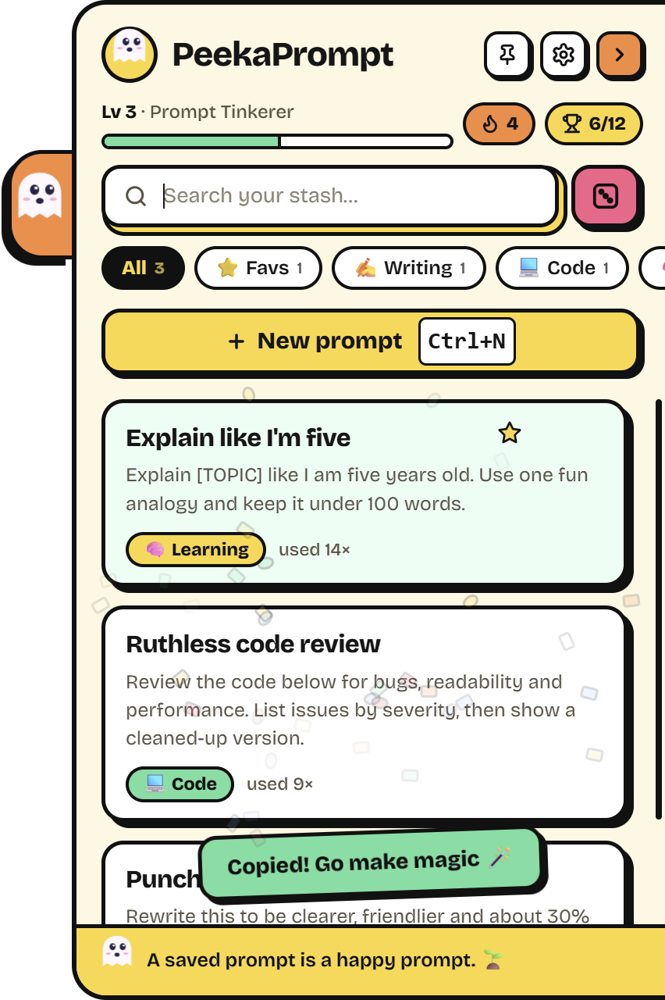
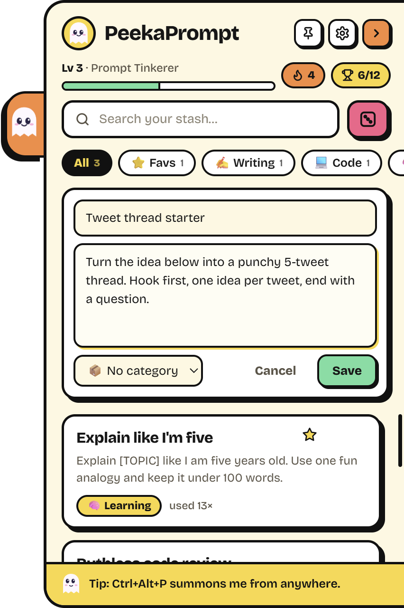
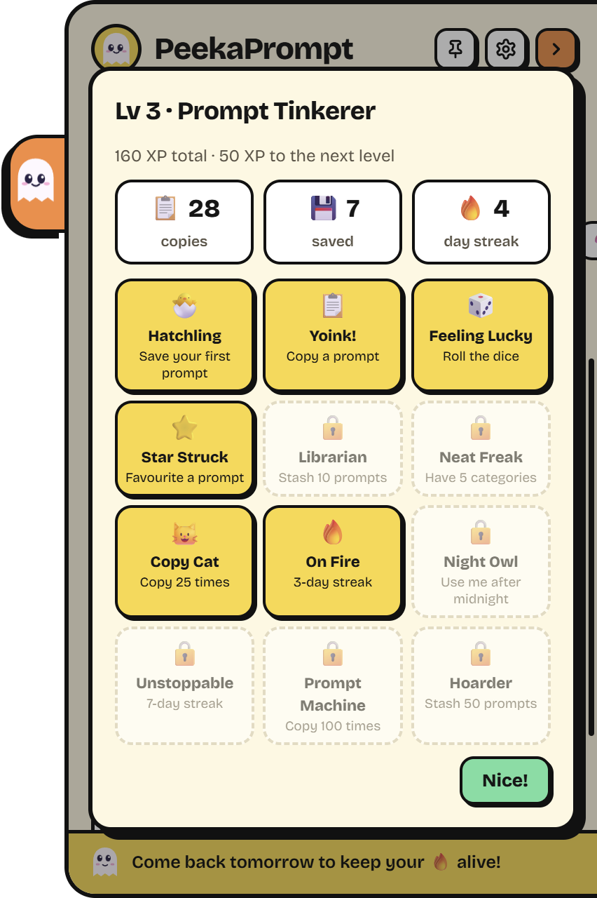

# 👻 PeekaPrompt

**A cheeky little prompt stash that hides on the edge of your screen.**

Peeky the ghost peeks out from the right edge of your desktop. Click it and a drawer slides out with all your saved AI prompts. Click a prompt and it's on your clipboard. The drawer then tucks itself away so you can paste.

No accounts, no cloud, no subscriptions. It's just your prompts, on your machine, one click away.

📖 **Read the story behind it:** [I built a free, open-source AI prompt manager that hides on the edge of my screen](https://medium.com/@gk0415439/free-open-source-ai-prompt-manager-peekaprompt-2eb7418771c8) (Medium)

<p align="center">
  
  
  
</p>

## Why?

I kept rewriting the same prompts from scratch, or digging through old chats to find "that one prompt that worked". Notes apps felt like a chore to open. I wanted something that's *always there* but never in the way, and a bit fun, so I'd actually use it.

## Features

- **Hides at the screen edge.** Peeky peeks out from the edge. Hover and it pops out to say hi; click and the drawer slides open.
- **One-click copy.** Click a card to copy it, and the drawer tucks itself away.
- **Categories.** Each one gets its own emoji and colour. Right-click a category to edit it.
- **Search and copy.** Type to filter, then press `Enter` to copy the top match.
- **Favourites ⭐** float to the top.
- **🎲 Surprise me** picks a random prompt from whatever you're viewing.
- **Global shortcut.** `Ctrl+Alt+P` opens it from anywhere.
- **Drag the tab** up or down the screen edge to move it.
- **Pin it open** while you work across windows.
- **Start with Windows** (optional).

### The fun stuff (aka why you'll keep using it)

- **XP and levels.** You earn XP for saving, copying and rolling the dice, and climb from *Prompt Pebble* to *Prompt Deity*.
- **Daily streaks 🔥** with a bonus the first time you use it each day.
- **12 badges** to unlock, including a sneaky Night Owl.
- **Peeky has feelings.** It blinks, its eyes follow your cursor, it wiggles when you hover, cheers when you copy and sulks when you delete.
- **Confetti** every time you copy. Obviously.

## Install

You need [Node.js](https://nodejs.org) 18 or newer.

```bash
git clone https://github.com/Gaurav-Kumar98/peekaprompt.git
cd peekaprompt
npm install
npm start
```

On Windows you can also double-click **`PeekaPrompt.vbs`** to launch it without a console window.

> If `npm start` complains that Electron failed to install, run `node node_modules/electron/install.js` once.

Built and tested on Windows 11. Electron is cross-platform, so macOS and Linux should work with `npm start`, but they haven't been tested yet. Reports and PRs are welcome!

## Shortcuts

| Key | Action |
|---|---|
| `Ctrl+Alt+P` | Open or tuck away, from anywhere |
| `Ctrl+N` | New prompt |
| `Ctrl+Enter` | Save the prompt you're writing |
| `Ctrl+F` | Focus search |
| `Enter` (in search) | Copy the top match |
| `Esc` | Close the dialog, cancel editing, or tuck away |

## Your data

Everything stays local, in one JSON file:

- Windows: `%APPDATA%\peekaprompt\prompts.json`
- macOS: `~/Library/Application Support/peekaprompt/prompts.json`
- Linux: `~/.config/peekaprompt/prompts.json`

Back it up, sync it with your own cloud folder, or edit it by hand. It's yours.

## How it's built

Plain [Electron](https://www.electronjs.org/) with vanilla JS, HTML and CSS: no framework, no build step.

| File | What it does |
|---|---|
| `main.js` | The window: docking to the screen edge, slide animations, click-through on transparent areas, the global shortcut, storage |
| `preload.js` | A small, sandboxed bridge between the window and the UI |
| `renderer.js` | The UI: prompts, categories, XP, streaks, badges, confetti, Peeky's moods |
| `styles.css` | The "Lemon Soda" theme |

## Contributing

Ideas, bug reports and PRs are all welcome. Some things that would be lovely:

- Fill-in variables like `{{topic}}` that ask you for a value when you copy
- Import and export
- More themes
- Docking to the left edge
- Packaged installers (electron-builder)

## License

[MIT](LICENSE) © 2026 Gaurav Kumar

The Bricolage Grotesque font is licensed under the SIL Open Font License, via [Fontsource](https://fontsource.org/fonts/bricolage-grotesque).
